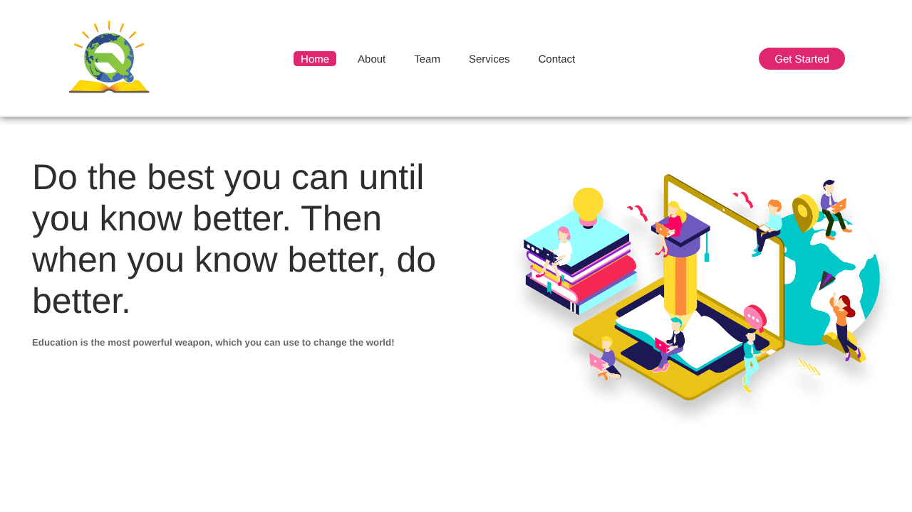
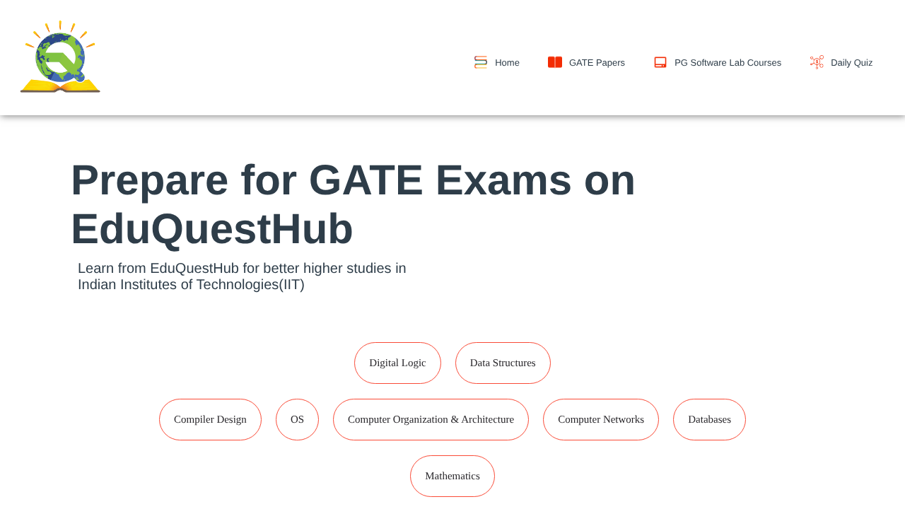
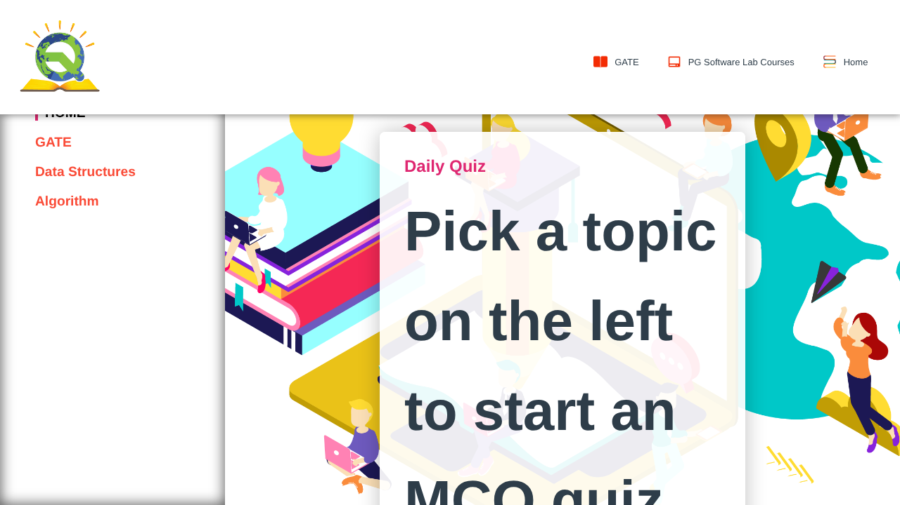

# EduQuestHub

**A GATE CSE and PG Software Lab learning portal.** It brings together curated video lectures, nine GATE CS papers (2017–2023) and embedded daily quizzes on one responsive static website.

Built as the course project for **PG Software Lab (CS-PGSL), IIT Ropar, 2023** by **Vaibhav Barsaiyan** and **Deepu Yadav**.

🔗 **Live demo:** https://vb-777.github.io/EduQuestHub/



---

## Features

| Page | What it does |
|---|---|
| **Home** (`index.html`) | Landing page with an About section that reveals on scroll, highlights, team, services, contact cards and a feedback form |
| **GATE CSE** (`gate.html`) | 8 core subjects (DS, OS, CN, DBMS, COA, Compiler Design, Digital Logic, Maths), each with an embedded lecture and a full playlist; downloadable GATE CS papers from 2017 to 2023 |
| **PG Software Lab** (`computer_courses.html`) | Lecture videos for the PGSL syllabus: LaTeX, Git & GitHub, AWK shell scripting, web scraping, trie, transfer learning, LSTM & GloVe |
| **Daily Quiz** (`quiz.html`) | Topic sidebar (GATE / Data Structures / Algorithms) that switches between embedded Google Forms quizzes |
| **Log In / Register** (`login.html`) | Animated toggle between the two forms, with client-side validation (password length and match, T&C acceptance gate) |

<p>
  
  
</p>

## Tech stack

- **HTML5, CSS3** – responsive layouts, CSS transitions and hover animations
- **JavaScript (ES5) + jQuery** – navigation behaviour, scroll-reveal, quiz panel switching, form validation
- **YouTube embeds** for lectures and **Google Forms** for quizzes
- **GitHub Pages** for hosting (no build step)

## Project structure

```
EduQuestHub/
├── index.html              # Home / landing page
├── gate.html               # GATE CSE preparation
├── computer_courses.html   # PG Software Lab courses
├── quiz.html               # Daily quizzes
├── login.html              # Log in / register UI
├── assets/
│   ├── css/                # style.css, subjects.css, quizStyle.css, loginStyle.css
│   ├── js/                 # script.js, jquery.min.js
│   └── images/
├── papers/                 # GATE CS papers, 2017–2023
└── docs/
    ├── PROJECT_PROPOSAL.md # Original project proposal
    └── screenshots/
```

## Run locally

No build or install is needed. Clone the repo and open `index.html`, or serve it:

```bash
git clone https://github.com/Vb-777/EduQuestHub.git
cd EduQuestHub
python3 -m http.server 8000   # then open http://localhost:8000
```

## Roadmap

The [project proposal](docs/PROJECT_PROPOSAL.md) describes the full vision. Items not yet built:

- [ ] Backend for real authentication (Node.js + MySQL + JWT). Login/Register is front-end only for now
- [ ] Native quiz engine with scoring, timers and strong/weak-topic analysis
- [ ] Personalised study path from quiz history
- [ ] Discussion forum and admin panel for content management
- [ ] Remaining lab topics: KD-Tree, Matplotlib, Containers & CNN

## Authors

- **Vaibhav Barsaiyan** – [GitHub](https://github.com/Vb-777) · [LinkedIn](https://www.linkedin.com/in/b7-vaibhav)
- **Deepu Yadav** – [LinkedIn](https://www.linkedin.com/in/deepu-yadav-a04197286/)

> GATE question papers are the property of the respective organising IITs and are included for educational reference only. Lecture videos belong to their YouTube creators.
